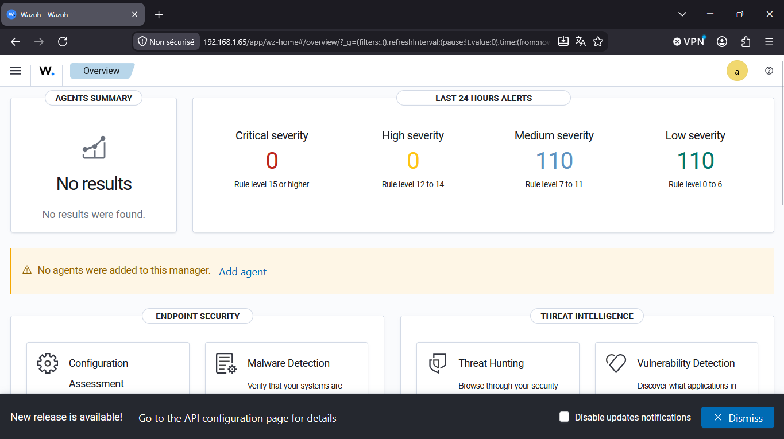
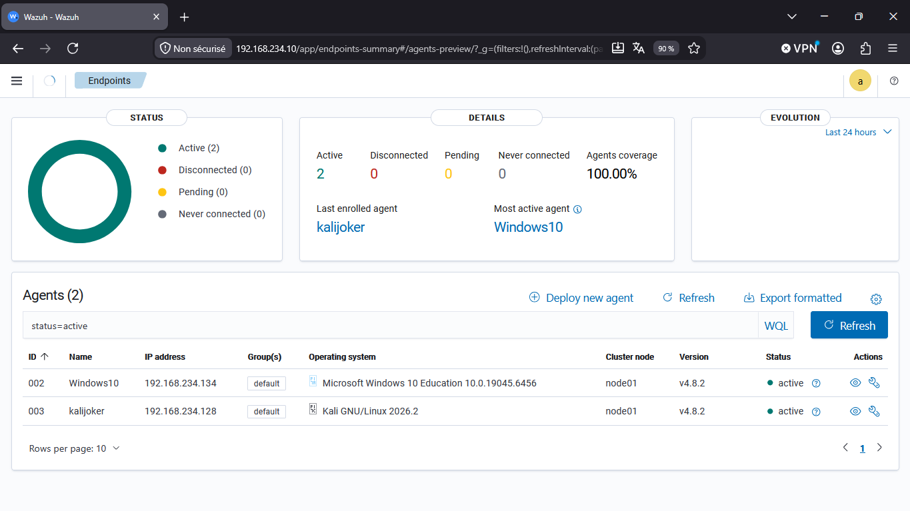
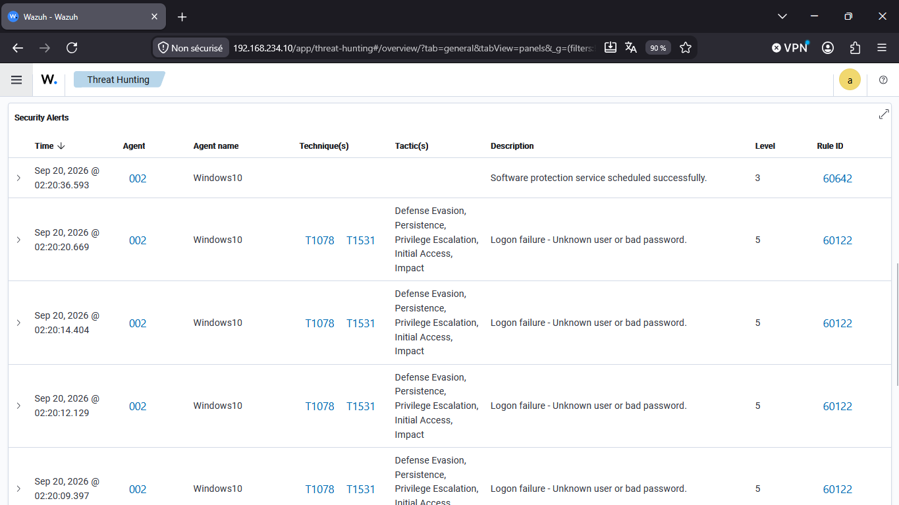
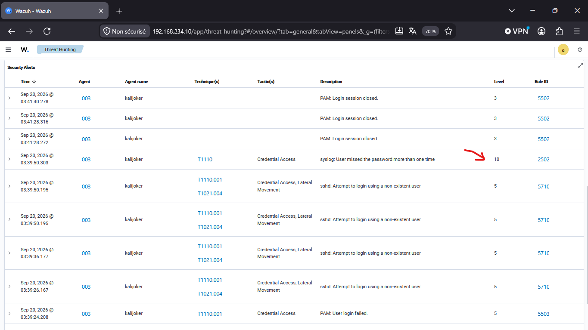
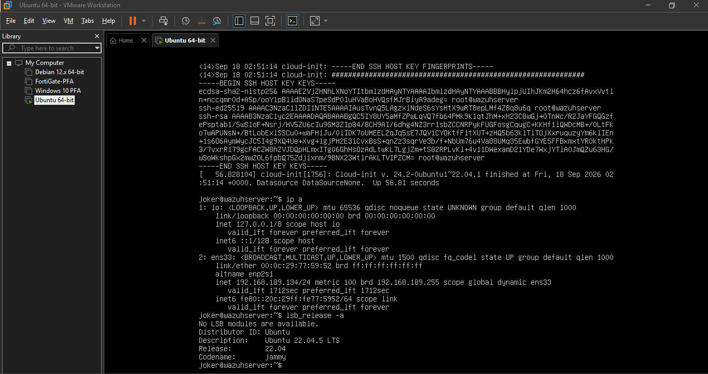

# 🛡️ Wazuh SIEM Lab - Détection d'intrusions en temps réel

## 📋 Contexte
Projet de Fin d'Année (PFA) : déploiement d'un SIEM (Security Information and Event Management) Wazuh 4.8.2 pour la surveillance et la détection d'attaques sur un environnement multi-OS (Windows 10 + Kali Linux).

## 🎯 Objectifs
- Installer et configurer un serveur Wazuh sur Ubuntu 22.04
- Déployer des agents sur Windows 10 et Kali Linux
- Détecter des attaques par brute force SSH et Windows
- Mapper les alertes sur le framework MITRE ATT&CK
- Analyser les alertes avec la méthode d'un analyste SOC

## 🏗️ Architecture

| Machine | Système | Rôle | IP |
|---------|---------|------|-----|
| Serveur | Ubuntu 22.04 | Wazuh Manager + Indexer + Dashboard | 192.168.234.10 |
| Agent 1 | Windows 10 | Endpoint supervisé | 192.168.234.134 |
| Agent 2 | Kali Linux 2026.2 | Endpoint supervisé | 192.168.234.128 |

**Réseau** : NAT VMware (VMnet8)

## 🔧 Technologies
- **SIEM** : Wazuh 4.8.2
- **Systèmes** : Ubuntu 22.04, Windows 10, Kali Linux
- **Virtualisation** : VMware Workstation
- **Framework** : MITRE ATT&CK (T1110, T1078, T1021.004)

## 📊 Résultats

### ✅ Couverture du parc
- 2 agents actifs (Windows 10 + Kali Linux)
- Couverture : **100%**

### ✅ Détection d'attaques
| Attaque | Règle Wazuh | Niveau | MITRE |
|---------|-------------|--------|-------|
| Brute force Windows (6 tentatives) | 60122 | 5 | T1078 |
| Brute force SSH (utilisateur inexistant) | 5710, 5712, 5716 | 5 | T1110.001 |
| **Brute force SSH caractérisée** | **2502** | **10** | **T1110** |

### ✅ Analyse SOC
Fiche d'analyse complète de l'incident "brute force SSH" avec :
- Qualification de l'attaque
- Mappage MITRE ATT&CK
- Phase de la kill chain (Credential Access)
- Recommandations de réponse

## 📸 Captures d'écran

### Dashboard Wazuh

### Agents actifs (couverture 100%)

### Installation de l'agent Windows

### Détection brute force Windows (règle 60122)

### Détection brute force SSH (règle 2502 niveau 10)

### Fiche agent

## 📄 Rapport complet
Voir le fichier **rapport-wazuh.pdf** pour la documentation technique complète (22 pages).

## 🎓 Compétences démontrées
- Déploiement d'un SIEM open-source (Wazuh)
- Configuration d'agents multi-OS (Windows, Linux)
- Collecte de logs (rsyslog, Event Logs Windows)
- Détection d'intrusions (IDS)
- Analyse d'alertes selon MITRE ATT&CK
- Méthode d'analyste SOC (qualification, corrélation)
- Résolution de problèmes complexes (réseau, versions, configurations)

## 🚀 Perspectives
- Activation de l'Active Response (blocage automatique)
- Écriture de règles personnalisées
- Comparaison avec Splunk / Elastic SIEM
- Préparation certification CompTIA CySA+ / BTL1

---
**Auteur** : Madini Machkour  
**Formation** : Cycle Ingénieur Cybersécurité - ISMAGI (2025-2027)  
**Année** : 2025-2026
